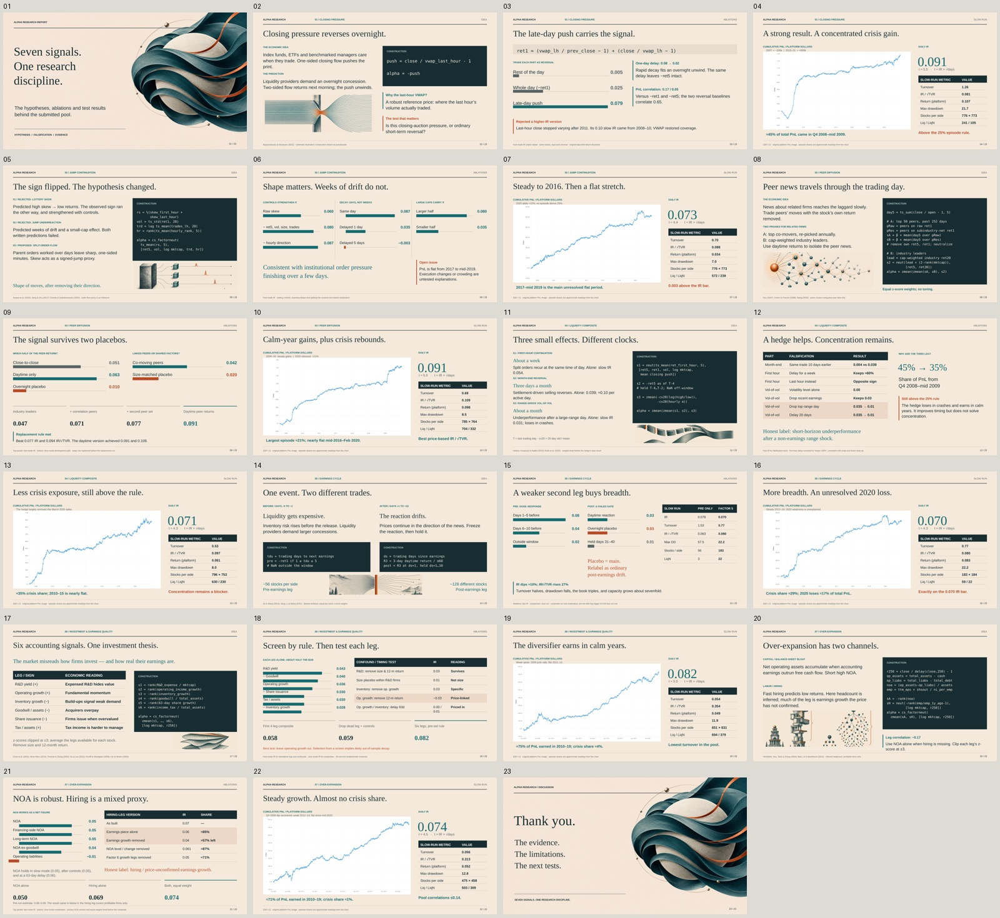

# Alpha Research — Interview Presentation

A complete 23-slide presentation with a financial editorial design, GPT-generated illustrations, editable research text and data visuals, original PnL charts, and speaker notes.

## Downloads

- [PowerPoint deck](deliverables/alpha-research.pptx?raw=true)
- [PDF deck](deliverables/alpha-research.pdf?raw=true)
- [Three design concepts](deliverables/design-concepts.png?raw=true)
- [All 23 slides as PNG images (ZIP)](deliverables/slide-images.zip?raw=true)
- [Deck overview](deliverables/deck-overview.jpg?raw=true)
- [Design and source notes](deliverables/readme.txt)

If GitHub displays a file page instead of downloading, use **Download raw file** on that page.

## Preview

[View replacement visual candidates A–F](design-candidates/README.md): new research-process covers and more literal factor illustrations, presented for selection.

## Content and validation

The original presentation sequence and all 23 talk tracks are retained in the PowerPoint speaker notes. The seven PnL images are unchanged copies of the supplied charts. Every slow-run table value was checked against the source deck, and all 23 slides were rendered and inspected.

Slide 12 corrects the first-hour delay result to **keeps approximately 60%**, consistent with the supplied script and factor write-up; the previous slide said **loses approximately 60%**.

The artwork was generated using the available GPT Image tool. That tool did not expose a model selector, so the exact `gpt-image-2.5` version could not be selected or verified. Text, tables, and ablation visuals remain editable in PowerPoint. The PDF and PNG exports preserve the appearance without requiring the presentation fonts.
