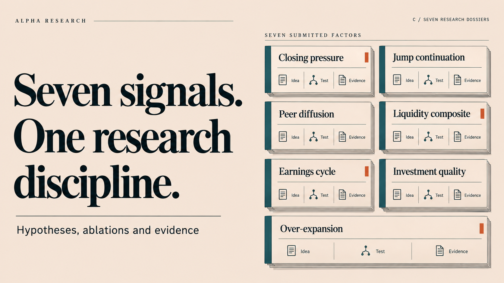
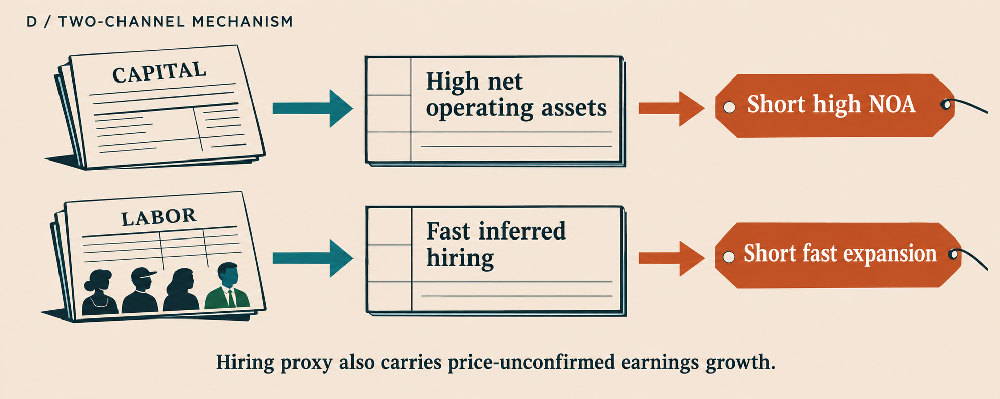
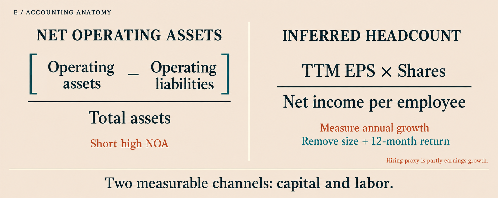
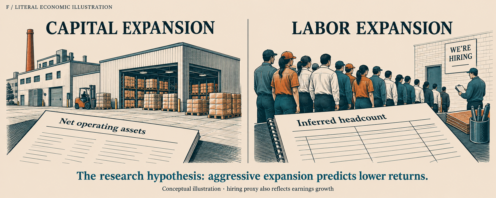

# Replacement visual candidates

Six GPT Image concepts from the design review. **B was selected for the cover and closing.** The published presentation now uses simplified D/F-inspired factor illustrations, removing embedded text and fine detail so they work in small slide regions. [See the applied revision](../deliverables/visual-update.jpg).

Covers A–C illustrate the alpha research process. Factor candidates D–F use **over-expansion** as the common example so the visual styles can be compared directly.

The selected direction has been adapted to all seven factors. These are conceptual illustrations, not new empirical results.

| Candidate | Direction | Emphasis |
| --- | --- | --- |
| A | Research pipeline | Hypothesis, signal construction, ablations, and submission |
| B | Research notebook | Tangible research notes, falsification questions, and caveats |
| C | Seven research dossiers | The seven submitted factors as an organized body of evidence |
| D | Two-channel mechanism | A labeled diagram explaining capital and labor signals |
| E | Accounting anatomy | The actual NOA and inferred-headcount calculations |
| F | Literal economic illustration | Recognizable capital expansion and hiring scenes |

Suggested pairing: **B + F**, preserving the editorial illustration style while making the research subject recognizable. **A + D** is an alternative emphasizing explicit process diagrams.

## A — Research pipeline

## B — Research notebook

## C — Seven research dossiers

## D — Two-channel mechanism

## E — Accounting anatomy

## F — Literal economic illustration

## How the chosen direction could extend across the deck

| Factor | Concrete subject for its illustration |
| --- | --- |
| Closing pressure | Closing-auction imbalance and the following morning's unwind |
| Jump continuation | A parent order split into child orders over several days |
| Peer diffusion | News transmitted between explicitly labeled related firms |
| Liquidity composite | Morning trading, month-end settlement, and a recent range shock |
| Earnings cycle | Separate reversal and drift windows around an earnings announcement |
| Investment quality | Six named accounting inputs combined into one signal |
| Over-expansion | Net operating assets and inferred hiring, retaining the earnings-growth caveat |

Illustration labels and formulas will be typeset as editable PowerPoint text when the selected direction is incorporated into the deck.
